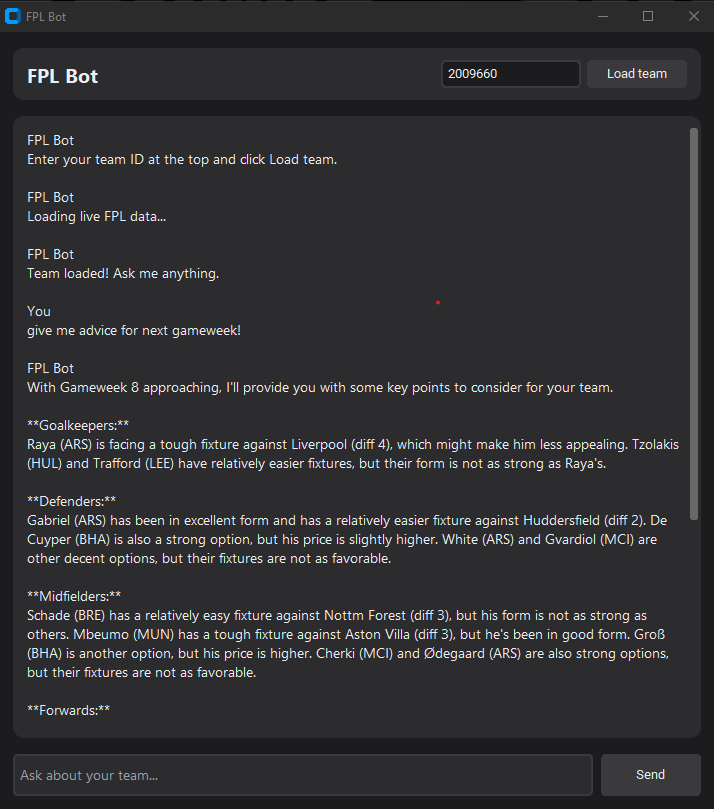

# FPL Bot

An AI desktop assistant for Fantasy Premier League. It pulls live stats, prices, fixtures and your squad from the official FPL API, then answers questions using a local AI model, so its answers are based on real data.

## Features
- Loads any FPL team by team ID
- Live player stats, form and prices
- Next three fixtures for every club, with difficulty ratings
- Chat window powered by Llama 3.1 running locally through Ollama

## Requirements
- Windows PC with Python 3
- Ollama installed, with the model: `ollama pull llama3.1:8b`
- Python packages: `pip install -r requirements.txt`

## How to run
`py fpl_app.py` opens the desktop app. `py fpl_bot.py` runs the terminal version.

Built as a hobby project while learning Python.
